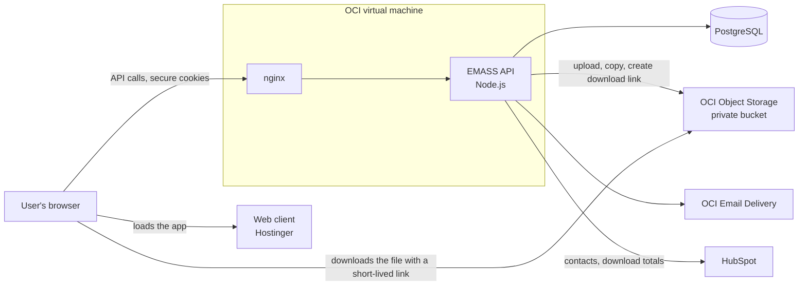
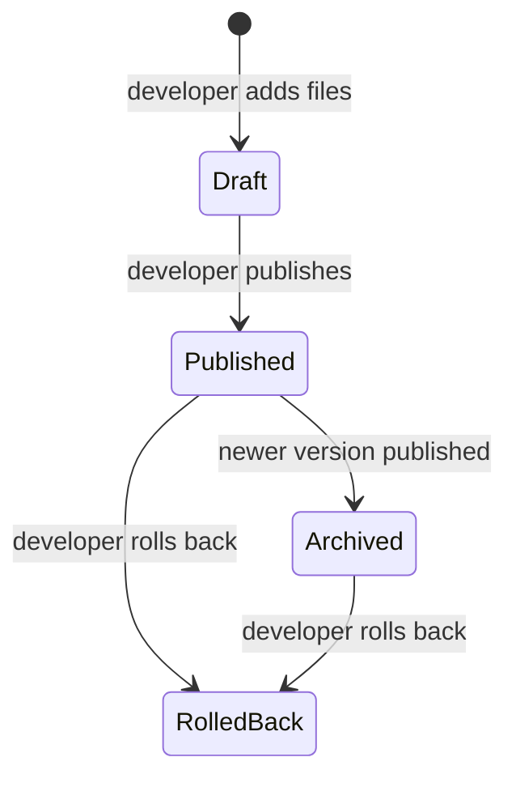
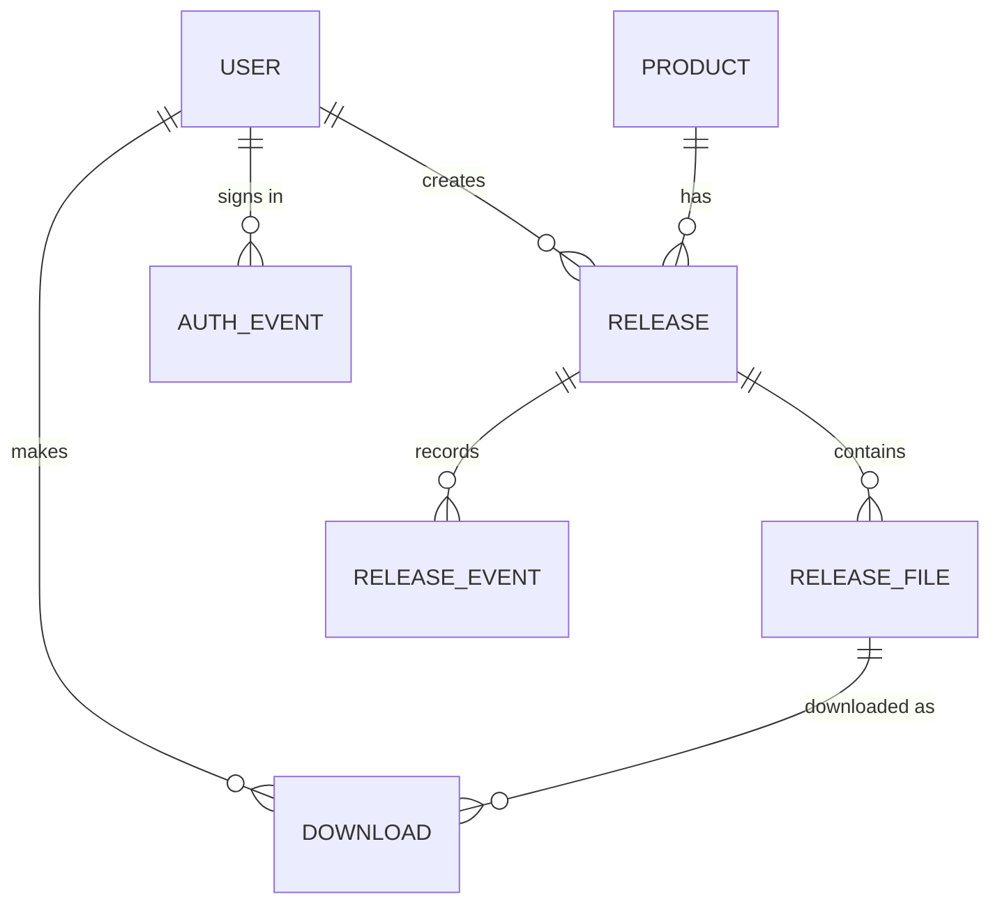

# EMASS Toolkit — Development Document

This document describes what was built for the EMASS Toolkit, how the system
is put together, how each part works, and how it was developed and deployed.
For how people use the portal day to day, see the [User Guide](user-guide.md).

---

## 1. Overview

The EMASS Toolkit is Nanoveu's private download portal for EMASS SDKs and
documentation. Approved customers sign in and download versioned files.
Nanoveu staff prepare and ship those files through the same portal.

The portal serves three groups:

| Group | What the portal gives them |
|---|---|
| **Customers** | A catalog of EMASS products, every shipped version, release notes, and verified downloads |
| **Developers** | A release editor to upload SDKs and documents, with automatic checks, and the whole release workflow: publish, rollback and notes |
| **Admins** | Sign-up approval, domain rules, and a dashboard; read-only access to releases |

This delivery covers the complete portal: the web client, the API, the
database, file storage, email, and the CRM link to HubSpot.

---

## 2. What was delivered

| Area | Delivered |
|---|---|
| **Accounts and access** | Self-service sign-up with email verification and captcha; approval queue for personal email addresses; blocking of competitor domains; password sign-in; email code (MFA) for every staff sign-in; password reset by email link |
| **Roles** | Customer, Developer and Admin, enforced by the API on every request |
| **Release management** | Drafts, publish, archive and rollback, with a full activity history per release |
| **Release editor** | Drag-and-drop upload of large files, version detected from the files, file type and platform mapping, Markdown release notes |
| **File integrity** | SHA-256 checksum of every file, computed on upload and shown to customers; checks that block wrong-version, already-shipped or duplicate installers |
| **Publishing and rollback** | One-click publish that moves files into the release storage and archives the previous version; rollback that restores the previous version |
| **Customer downloads** | Product catalog and pages, version picker, one-time licence acceptance, secure time-limited download links, checksum verification instructions |
| **Notifications** | Sign-up, approval, sign-in and password emails; "new version available" and "version withdrawn" emails to the customers concerned |
| **Admin tools** | Dashboard with user, sign-up and download figures and the sign-up queue; sign-up approval page; domain rules page |
| **CRM** | Customer contacts, download totals and a first-download note sent to HubSpot |
| **Audit** | Logs of sign-ins, customer downloads, staff downloads and every release change |
| **API documentation** | OpenAPI specification and an HTML reference, generated from the code |

---

## 3. System architecture

**Web client.** A React single-page application, built as static files and
hosted on Hostinger. It holds no business rules: everything it shows comes
from the API, and every action goes through the API.

**API.** A Node.js service on an OCI virtual machine, behind nginx. It owns
all the rules: who may see what, who may do what, which state a release is
in, and when emails go out. It also runs two kinds of background work inside
the same process: publish jobs and the email sender.

**PostgreSQL.** Holds users, products, releases, file records, activity
history, download logs and the email queue.

**OCI Object Storage.** Holds the actual files in one private bucket: a
`draft/` area for files being prepared and a `publish/` area for shipped files.
Nothing is ever public. The API reaches OCI through the virtual machine's own
identity, so no cloud keys are stored on the server.

**OCI Email Delivery.** Sends every email the portal produces.

**HubSpot.** Receives customer contacts and download activity. The portal only
writes to HubSpot; nothing the portal decides depends on it.

---

## 4. Technology stack

| Layer | Technology |
|---|---|
| Web client | React, TypeScript, Vite, Tailwind CSS |
| API | Node.js 22, Express 5, TypeScript |
| Database | PostgreSQL, Prisma 7 |
| Validation | Zod |
| Logging | pino |
| File storage | OCI Object Storage (OCI SDK) |
| Email | OCI Email Delivery (OCI SDK) |
| CRM | HubSpot API |
| Testing | Vitest, Supertest, real PostgreSQL test database |
| Code quality | ESLint, Prettier |
| API documentation | OpenAPI 3, Redocly |

---

## 5. How it works

### 5.1 Registration and approval

Sign-up happens on one page, in three steps. The person enters their details
(work email, name, country, company, job title and intended use) and solves a
captcha. The portal emails a 6-digit code, valid for 10 minutes. Once the
code is confirmed, the person chooses a password and the account is created.

The email domain decides what happens next. Admins maintain the domain lists
in the portal:

| Domain | Outcome |
|---|---|
| Company domain | Account active immediately; the person is signed in and welcomed by email |
| Free-mail domain (Gmail, Outlook…) | Account waits in the approval queue; the person is emailed when an admin approves or rejects it |
| Competitor domain | Sign-up refused before any code is sent |

On activation, the customer's contact is created or updated in HubSpot.

### 5.2 Sign-in and sessions

Customers sign in with email and password. Staff enter their password and
then a 6-digit code emailed to them, every time.

The session is held in two secure, httpOnly cookies that page scripts can't
read: a short access token (15 minutes) and a longer refresh token (14 days).
The client renews the access token quietly in the background. Refresh tokens
are single-use; if an old one is ever presented again, the portal treats it as
stolen and signs that user out on every device.

Password reset works through an emailed link valid for 30 minutes. The portal
never reveals whether an email address has an account.

### 5.3 Release lifecycle

- Developers own releases from start to finish, and any developer can manage
  any release.
- Admins can read releases and download their files, but can't change them.
- After publishing, only the release notes can change.
- Versions follow semantic versioning (for example 1.4.0). Each is unique per
  product and must be newer than anything already shipped.
- Every change, with who made it and any reason, is recorded and
  shown on the release's Activity timeline.

### 5.4 Uploads and file checks

Files upload as soon as the developer drops them in the editor, two at a
time. The first file creates the draft, and each file is saved the moment its
upload finishes.

Before a file uploads, the portal checks it:

1. The API reads a few small parts of the file to find the version recorded
   inside the installer (Windows, macOS and Ubuntu package formats) or in the
   document.
2. The browser computes the file's SHA-256 checksum.
3. Installers are **blocked** if their version doesn't match the release, if
   that version has already shipped, or if the identical file was uploaded
   before. Documents only produce **warnings**, which the developer confirms
   when publishing and which stay in the release's history.

The file then streams through the API into private storage. The API computes
the checksum again as the data passes and rejects the file if the two don't
match. After storage, the file is checked once more.

When all SDK file names agree on a version, the editor fills the version in
and locks it, so the version and the files can't disagree.

### 5.5 File storage

- Files being prepared live under **draft/** in the bucket.
- On publish they are copied under **publish/**, organised by product and
  version, and the draft copies are removed.
- A stored file is never overwritten: every version is a new object.
- The bucket is private. Files leave storage only through individual,
  time-limited download links.

### 5.6 Publishing

When a developer publishes, the API checks the draft (files, version, file
rules, and that any warnings were confirmed), then a background job:

1. refuses further changes to the draft while it runs;
2. copies each file from draft/ to publish/;
3. in a single database transaction, archives the currently published version
   and publishes the new one;
4. removes the draft copies.

The developer watches its progress in the portal. The process is all or nothing:
if anything fails before step 3, nothing changes and it can be run again. When
the new version is live, every customer who downloaded an earlier version of
that product is emailed that it's available.

### 5.7 Rollback

Rollback takes effect immediately and copies nothing.

- **Rolling back the published version** withdraws it from customers. The
  newest earlier version becomes published again, if there is one.
- **Rolling back an archived version** removes it from the list of previous
  versions; the published version is unchanged.

The developer records an internal reason, kept in the release history, and may
add a message for customers. Every customer who downloaded the withdrawn
version is emailed, and the release's Activity shows how many were notified.

### 5.8 Downloads

Before a customer's first download, the portal shows the EMASS Software
Licence. Acceptance is recorded once per account, with the time and the
wording version, and the API refuses downloads until it exists.

On each click, the API checks that the file belongs to a shipped version of
an active product, creates a **read-only link to that single file, valid for
one hour**, records the download, and returns the link. The browser downloads
directly from storage. Every click creates a new link.

Each file's SHA-256 checksum is shown next to it, with the command to verify
it on Windows, macOS or Linux.

An **external product** (`kind: LINK`) has no releases or files. Its catalog
card has one button that opens an external `https://` URL in a new tab;
nothing is logged, and no licence is needed. Developers edit its name,
description, URL and button label on the External Product page
(`PATCH /api/products/:id/external`, DEV only); re-running the product seed
never overwrites those. The server refuses releases for external products and
keeps them out of the release product picker.

Staff can download files from any release, including unpublished ones, to test
a build. Those links last 5 minutes and are logged separately, so testing
never counts as a customer download.

### 5.9 Notifications

| Type | How it's sent |
|---|---|
| Personal emails (verification and sign-in codes, password reset, welcome, approval, rejection) | Immediately, when the action happens |
| Bulk emails ("version withdrawn", "new version available") | Through an email queue in the database |

The bulk emails are queued in the same database transaction as the rollback
or publish, so the change and its notices always go together. A sender inside
the API sends them at a steady pace, withdrawal notices first. Temporary
failures are retried after 1 minute, 5 minutes, 30 minutes and 2 hours. If the
API restarts, sending resumes where it left off.

### 5.10 HubSpot

When a customer account becomes active, the portal creates or updates the
HubSpot contact with their sign-up details and intended use. Each customer
download updates their totals (number of downloads, first and last download)
and the first download adds a note to the contact. HubSpot updates never
block a sign-up or download; if HubSpot is unavailable, the next download or a
resync script brings it up to date.

### 5.11 Admin dashboard

The dashboard shows active users, pending sign-ups, blocked competitors,
rejected sign-ups and downloads (total and last 30 days). It also shows the
oldest sign-ups waiting for
approval. It refreshes every 30 seconds while open.

The **Customers** page (`GET /api/admin/customers`, admin only) lists customer
accounts newest first, keyset-paginated on (created, id), with search on name,
email and company and filters on status and "has downloaded". Download totals
and the first and last download (time and a "Product vX — file" label) are
kept on the user row in the same transaction as each download, so the page is
one query on one table. `releases:purge` deletes download rows without
lowering these totals, so a test purge leaves them overstated.

---

## 6. Security and access control

- **Roles enforced on the server.** Every request is checked by the API; the
  interface only hides what a role can't use.
- **Data isolation.** Users can only reach their own data, and the tests prove
  that one user can't access another's.
- **Private storage.** The bucket is private. Customers get a one-hour,
  read-only link to one shipped file per click; unshipped files are never
  available to customers.
- **Staff MFA.** Every staff sign-in needs a code sent by email.
- **Sign-up protection.** Captcha, email verification, domain rules and admin
  approval for personal addresses.
- **Tokens in secure cookies only.** No token ever appears in a page or a
  response; reused refresh tokens sign the user out everywhere.
- **Origin check.** The API only accepts browser requests from the portal's
  own web addresses.
- **No cloud keys on disk.** The API authenticates to OCI with the virtual
  machine's identity.
- **Safe errors.** Every error returns a clear message and code; internal
  details are written to the server log only.
- **Audit trail.** Sign-ins and failed attempts, customer downloads, staff
  downloads and every release change are recorded with who and when.
- **Passwords** are stored as bcrypt hashes; verification codes and reset
  links are stored hashed.

---

## 7. Data model

| Entity | Holds |
|---|---|
| **User** | Profile, role, status, sign-up details, licence acceptance, download totals |
| **Product** | The EMASS products in the catalog. `kind` is RELEASES (ships versioned files) or LINK (only a catalog button opening `linkUrl`, labelled `linkLabel`) |
| **Release** | One version of a product: state, version, release notes |
| **ReleaseFile** | One file of a release: name, type, platform, size, SHA-256, storage location |
| **ReleaseEvent** | The history of a release: each action, who did it, feedback or reason |
| **Download** | Each customer download: who, which file, when |
| **ActivityLog** | Staff actions such as test downloads |
| **AuthEvent** | Sign-ins, failed attempts and password resets |
| **EmailDomainPolicy** | The free-mail and competitor domain lists |
| **EmailOutbox** | The queue of bulk emails and their delivery status |

---

## 8. How it was developed

**Structure.** One repository holds the web client and the API. The API is
layered: routes receive requests, controllers validate them, and services hold
the business logic. Every response has the same shape, and every error passes
through one handler.

**Validation.** Every request is validated against a schema that gives a
specific message for each missing or wrong field. The server also validates
its own configuration at startup and refuses to run if anything is missing.

**Testing.** Testing is integration-first. Automated tests call the real API
against a real PostgreSQL test database, not mocks. Pure logic, such as the
file parsers and the pre-publish rules, has its own unit tests. Every endpoint that
returns user data is tested to prove other users can't reach it.

**Documentation.** The API reference (OpenAPI) is generated from the code. A
decision record was written for each module as it was completed, in
`server/docs/`.

**Timeline.** Development ran from 17 October to 2 November 2026.

| Date | Milestone |
|---|---|
| 17 Oct | Project started; Nanoveu visual theme |
| 19 Oct | Client and API combined into one repository |
| 20 Oct | First version of accounts and sign-in |
| 23 Oct | Sign-up with email verification; password reset |
| 27 Oct | Release management and version control; admin dashboard |
| 28 Oct | Upload progress; hosting and cross-origin setup; download counts on the dashboard |
| 30 Oct | Files-first release editor; sign-up page redesign; email templates |
| 2 Nov | Email queue for rollback and release notices |

---

## 9. Deployment

| Component | Where it runs |
|---|---|
| Web client | Static files on Hostinger |
| API | Node.js on an OCI virtual machine, behind nginx |
| Database | PostgreSQL |
| Files | OCI Object Storage: one private bucket with draft/ and publish/ areas |
| Email | OCI Email Delivery |
| CRM | HubSpot |

- The API is compiled from TypeScript and runs as a Node.js process. nginx
  receives the traffic and passes it to the API.
- The API reaches OCI Object Storage and Email Delivery with the virtual
  machine's own identity (instance principal), granted only the permissions
  it needs on the bucket.
- The web client is built once and uploaded to Hostinger as static files.
- At startup the API checks its configuration and refuses to start if
  anything required is missing. In production it also refuses to start
  without OCI storage.

---

## 10. Operations

**Running inside the API.** Publish jobs run in the background and report
progress to the developer. The email sender wakes when there is mail to send and
on startup, so nothing queued is lost on a restart.

**Logging.** The API writes structured logs: one short line per request, plus
full detail for any unexpected error. Secrets are never logged.

**Maintenance scripts.**

| Script | Purpose |
|---|---|
| Seed products | Loads the EMASS product catalog |
| Seed domains | Loads the free-mail and competitor domain lists |
| Seed users | Creates staff accounts |
| HubSpot setup | Creates the portal's custom fields in HubSpot |
| HubSpot resync | Pushes download totals to HubSpot again |
| Release purge | Permanently removes test releases; previews by default |
| Storage checks | Verifies uploads and copies against the real bucket |
| Email preview | Renders every email template for review |
| API docs | Regenerates the OpenAPI reference |

---

## 11. Related documents

| Document | Contents |
|---|---|
| [User Guide](user-guide.md) | How customers, developers and admins use the portal |
| [Architecture](../server/docs/architecture.md) | Technical architecture and conventions |
| [Release management](../server/docs/releases/release-management.md) | Release workflow decisions |
| [File checks](../server/docs/releases/file-checks.md) | Upload checks in detail |
| [Downloads](../server/docs/downloads/downloads.md) | Download links and the licence |
| [Email outbox](../server/docs/operations/email-outbox.md) | Bulk email queue |
| [Release storage](../server/docs/operations/release-storage.md) | Storage and permissions checklist |
| [HubSpot setup](../server/docs/operations/hubspot-setup.md) | Connecting HubSpot |
