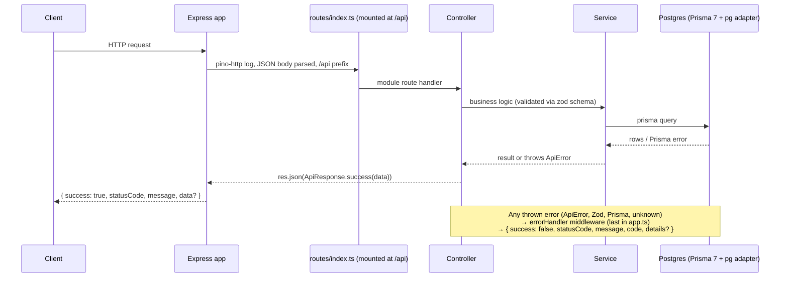

# EMASS-Toolkit — Architecture

## 1. Overview

Backend for the EMASS-Toolkit gated download portal (Nanoveu SDKs/docs).
Layered Express API with a strict response contract and mandatory data
isolation between users. Built by materializing the auth, email and storage
feature code directly into `src/` — the starter-kit scaffold/overlay model was
retired (see §12).

| Layer       | Technology                                                                                     |
| ----------- | ---------------------------------------------------------------------------------------------- |
| Runtime     | Node.js 22, ESM (`"type": "module"`)                                                           |
| Web         | Express 5                                                                                      |
| Language    | TypeScript (strict, `module: NodeNext`) — `tsc` = TS 7 (native), `tsc6` = TS 6 API for tooling |
| ORM         | Prisma 7 + `@prisma/adapter-pg`                                                                |
| DB          | PostgreSQL (dev + test `_test`)                                                                |
| Validation  | Zod 4                                                                                          |
| Logging     | pino + pino-http                                                                               |
| Lint/Format | ESLint 9 (flat) + Prettier                                                                     |
| Testing     | Vitest 4 + Supertest                                                                           |

## 2. Layers

Single layer — `src/`:

| Layer   | Where  | Contents                                                                                                                                |
| ------- | ------ | --------------------------------------------------------------------------------------------------------------------------------------- |
| **app** | `src/` | app shell, configs (env validation, logger, prisma, cookie, email, storage), auth/email/storage modules, middleware, health + docs APIs |

Rules:

- Business logic lives in `src/services/**`; routes stay thin, controllers
  forward errors via Express 5 (no try/catch), the errorHandler middleware is
  the single failure funnel.

## 3. Project structure

```
src/
├── configs/       # env.ts (zod env validation, fail-fast), logger.ts (pino),
│                  # prisma.ts (PrismaClient singleton w/ adapter),
│                  # cookie.config.ts, email.ts, storage.ts
├── routes/        # thin routers only — index.ts is the explicit loader
│   ├── index.ts   # imports every router, mounted at /api
│   ├── health.routes.ts
│   ├── docs.routes.ts
│   └── auth.routes.ts
├── controllers/   # flat handler files (health, docs, auth)
├── middleware/    # auth (requireAuth), admin, upload (multer), error-handler
├── services/      # per-module folders (the only folders allowed)
│   ├── auth/      # auth.service, token.service, otp.service, auth.utils, auth.errors
│   ├── email/     # email.service, email.utils, templates/
│   └── storage/   # storage.service (generic OCI objects + PAR URLs)
├── schemas/       # zod DTO schemas (auth.schema.ts)
└── utils/         # truly cross-cutting: api-response, api-error, error-handler

scripts/
├── generate-openapi.ts   # health + auth paths, EMASS Toolkit spec
└── openapi-helpers.ts    # { success, statusCode, message, data? } envelope helpers

prisma/schema.prisma   # User/RefreshToken/Otp + User/OtpPurpose enums
prisma.config.ts       # datasource.url = env("DATABASE_URL"), migrations path
eslint.config.js       # flat: js.recommended + typescript-eslint + prettier
vitest.config.ts       # setupFiles + fileParallelism: false
vitest.setup.ts        # refuses to run unless DATABASE_URL contains "_test"
bruno/starterkit/      # runnable API collection (health + Auth)
tests/
├── helpers/       # shared utilities (resetDb, auth factories)
├── unit/          # pure logic only
└── integration/   # ALL Supertest/app-level tests (DB-touching or not)
```

Rule: routes/controllers are flat single files; only services may contain
per-module folders.

## 4. Request lifecycle



Controllers have no try/catch — Express 5 forwards async rejections to the
error handler automatically; services translate known errors into ApiError.

## 5. API contract

Every response — success or failure — carries `success`, `statusCode`, `message`.

| Success                                         | Error                                                     |
| ----------------------------------------------- | --------------------------------------------------------- |
| `{ success: true, statusCode, message, data? }` | `{ success: false, statusCode, message, code, details? }` |

- `data` is omitted entirely when a response carries no payload (e.g. health)
- `details` is omitted unless the error carries context (e.g. zod flattened field errors)
- Validation errors: `message` is the **first** Zod issue message; `details`
  carries ALL issues — `formErrors` for root-level problems and `fieldErrors`
  for per-field problems; empty sections are omitted, `details` is never `{}`.
- Built via `ApiResponse.success(data, message?, statusCode?)` /
  `ApiResponse.ok(message?, statusCode?)` and `ApiError` (factories:
  `badRequest`, `unauthorized`, `notFound`, `conflict`)

```json
{ "success": true, "statusCode": 200, "message": "OK" }
{ "success": false, "statusCode": 400, "message": "Email is required", "code": "VALIDATION_ERROR",
  "details": { "formErrors": ["Request body is required"], "fieldErrors": { "email": ["Email is required"] } } }
```

## 6. Error handling

All errors funnel through one errorHandler middleware; every branch ends in a
response, unexpected errors are logged server-side with pino (plus a requestId)
before responding.

| Error                                       | HTTP    | `code`             | `message`                                                   | Logged                       |
| ------------------------------------------- | ------- | ------------------ | ----------------------------------------------------------- | ---------------------------- |
| ApiError                                    | its own | its own            | its own                                                     | no (client-facing by design) |
| ZodError                                    | 400     | `VALIDATION_ERROR` | first Zod issue message                                     | no                           |
| Malformed JSON body                         | 400     | `INVALID_JSON`     | Malformed JSON body                                         | no                           |
| Prisma P2002 / P2003                        | 409     | `CONFLICT`         | translated (e.g. "A record with this value already exists") | no                           |
| Prisma P2025                                | 404     | `NOT_FOUND`        | Record not found                                            | no                           |
| PrismaClientValidationError                 | 400     | `VALIDATION_ERROR` | Invalid request data                                        | no                           |
| Other Prisma (init/rust panic/unknown code) | 500     | `INTERNAL_ERROR`   | Internal server error                                       | yes                          |
| Anything else / non-Error throws            | 500     | `INTERNAL_ERROR`   | Internal server error                                       | yes, with requestId          |

Known Prisma codes are translated in the **service layer** where context is
known (e.g. "email already exists"); the middleware is the fallback.

## 7. Database (Prisma 7)

- Connection uses the **driver adapter**: `PrismaPg({ connectionString: process.env.DATABASE_URL })` + `PrismaClient({ adapter })` — singleton in `src/configs/prisma.ts`
- Prisma 7 has no `url` in `schema.prisma`; the CLI reads it from `prisma.config.ts` (`defineConfig` + `env("DATABASE_URL")`)
- Schema: `User` (email unique, password, emailVerified, role `USER/DEV/ADMIN`),
  `RefreshToken`, `Otp` (`SIGNUP_VERIFY`/`PASSWORD_RESET`) + enums — see
  `prisma/schema.prisma`
- Migrations: **never run without explicit approval**; apply to test DB via
  `npm run test:migrate`
- This repo retains 18 legacy migration folders from its original Held app;
  the schema no longer matches them (accepted drift). Recommended next step:
  wipe them and create one clean `init` migration — pending approval (Gate G1).

### 7a. Migrations on Windows/git-bash

`prisma migrate dev` is non-interactive in this shell and fails on confirmation
prompts. Workflow: `prisma migrate diff --from-config-datasource --to-schema
prisma/schema.prisma --script` into a fresh
`prisma/migrations/<timestamp>_<name>/migration.sql`, then `prisma migrate
deploy` for dev and `npm run test:migrate` for the test DB. Only one live
migration folder per change — delete empty leftovers.

## 8. Environment

| File           | Purpose                                                                               | Loaded by                                      |
| -------------- | ------------------------------------------------------------------------------------- | ---------------------------------------------- |
| `.env`         | dev: `PORT`, `DATABASE_URL`, `JWT_SECRET`, logging, optional email/storage keys       | `dotenv/config` in server.ts; prisma.config.ts |
| `.env.test`    | tests: `DATABASE_URL` → `*_test`, `JWT_SECRET`, `EMAIL_PROVIDER=console` (gitignored) | dotenv-cli in test scripts                     |
| `.env.example` | tracked template of all vars                                                          | manual copy                                    |

- `src/configs/env.ts` validates the environment with zod **eagerly on import**
  — a misconfigured server fails fast listing every missing/invalid key.
  `JWT_SECRET` is required at boot; `OCI_*` / `EMAIL_FROM_ADDRESS` are optional
  at boot (dev/test run without cloud access) but `EMAIL_PROVIDER=oci`
  cross-validates its required keys via schema `superRefine`; storage keys are
  enforced lazily by `configs/storage.ts` on first use.
- Logging: pino JSON to stdout (`LOG_LEVEL`, default `info`; silent under
  `NODE_ENV=test`). Pipe through `pino-pretty` in dev if desired. `pino-http`
  logs every request (id, method, url, status, responseTime).

### 8a. LAN development hosting

`app.listen(port)` binds all interfaces, so a single `npm run dev` serves both
`localhost:PORT` and the machine's LAN IP. Exposing it to other devices needs a
one-time firewall rule (run once as Administrator):

```
netsh advfirewall firewall add rule name="EMASS Toolkit API" dir=in action=allow protocol=TCP localport=5000 profile=private
```

`profile=private` keeps inbound blocked on public networks. Security note: this
exposes the API to anyone on the same private network — fine for development,
not a production posture.

## 9. Testing

| Command                    | Runs                                      |
| -------------------------- | ----------------------------------------- |
| `npm run test`             | everything (dotenv-cli injects .env.test) |
| `npm run test:integration` | `tests/integration/` only                 |
| `npm run test:migrate`     | Prisma migrations against the test DB     |

- Integration-first (Supertest against the real app + real Postgres); unit tests only for pure logic
- Every DB-touching test file starts with `beforeAll(resetDb)` — `resetDb` truncates all public tables (`RESTART IDENTITY CASCADE`), **never `_prisma_migrations`** (wiping it breaks `migrate deploy` with P3018); non-DB files stay DB-free
- `fileParallelism: false` — files run serially so truncation can't wipe another file mid-run
- Every route touching user-scoped data must prove cross-user access fails
- Current status: unit suites green (105 tests); auth integration suites
  (`auth.test.ts`, `password-reset.test.ts`) written and gated on Gate G1
  (test DB not yet migrated to the new schema).

## 10. API documentation

The API is documented as an OpenAPI 3.0 spec generated from code, rendered to a
shareable static HTML page with Redocly.

| Command             | Runs                                                                                                                      |
| ------------------- | ------------------------------------------------------------------------------------------------------------------------- |
| `npm run docs:spec` | regenerates `docs/api/openapi.json` from `scripts/generate-openapi.ts` (envelope helpers in `scripts/openapi-helpers.ts`) |
| `npm run docs:html` | renders `docs/api/index.html` (`redocly build-docs`)                                                                      |
| `npm run docs`      | both                                                                                                                      |

- Auth paths and schemas live in `scripts/generate-openapi.ts` alongside the
  health paths (no marker indirection).
- **Regenerate whenever a route or schema changes** — the spec is derived from
  the schemas, so drift only happens if you forget to run `npm run docs`.

## 11. Adding a module

1. `src/schemas/{module}.schema.ts` — zod DTOs
2. `src/services/{module}/` — business logic, ApiErrors translated here
3. `src/controllers/{module}.controller.ts` — flat handler
4. `src/routes/{module}.routes.ts` — thin router calling the controller
5. `src/routes/index.ts` — one line: `router.use({module}Routes)`
6. `tests/integration/{module}.test.ts` — Supertest suite, `beforeAll(resetDb)` if DB-touching

## 12. Roadmap / known gaps

- **Gate G1 — migration** (blocking): splice is in `prisma/schema.prisma`, no
  migration run. Recommended: wipe 18 legacy Held migrations → one clean `init`
  migration → `npm run test:migrate`, then unblock the auth integration suites.
- **Release module** — products/versions/files, staged → published → archived
  flow, upload (multer + `storage.uploadObject`), download via 1h token +
  60-second object PAR, SHA-256 checksums, roles (`DEV` stages, `ADMIN`
  approves/rolls back).
- **Rate limiting** on auth endpoints before production exposure.
- **Signup domain approval / waitlist** — spec'd in `docs/auth/auth-module.md`,
  deliberately not built yet.
- **HubSpot contact sync** (one-way outbound) — later, per AGENTS.md.

> [!info] Keep this doc current: update it whenever a dependency, contract, or structural decision changes.
