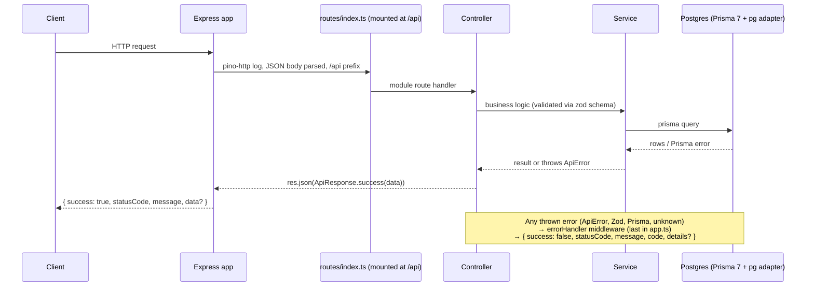

# EMASS-Toolkit — Architecture

## 1. Overview

Backend for the EMASS-Toolkit gated download portal (Nanoveu SDKs/docs).
Layered Express API with a strict response contract and mandatory data
isolation between users. Built by materializing the auth, email and storage
feature code directly into `src/` — the starter-kit scaffold/overlay model was
retired (see §13).

| Layer       | Technology                                                                                     |
| ----------- | ---------------------------------------------------------------------------------------------- |
| Runtime     | Node.js 22, ESM (`"type": "module"`)                                                           |
| Web         | Express 5                                                                                      |
| Language    | TypeScript (strict, `module: NodeNext`) — `tsc` = TS 7 (native), `tsc6` = TS 6 API for tooling |
| ORM         | Prisma 7 + `@prisma/adapter-pg`                                                                |
| DB          | PostgreSQL (dev + test `-test`)                                                                |
| Validation  | Zod 4                                                                                          |
| Logging     | pino + pino-http                                                                               |
| Lint/Format | ESLint 9 (flat) + Prettier                                                                     |
| Testing     | Vitest 4 + Supertest                                                                           |

## 2. Layers

Single layer — `src/`:

| Layer   | Where  | Contents                                                                                                                                |
| ------- | ------ | --------------------------------------------------------------------------------------------------------------------------------------- |
| **app** | `src/` | app shell, configs (env validation, logger, prisma, cookie, email, storage), auth/email/storage modules, middleware, health + docs APIs |

Rules:

- Business logic lives in `src/services/**`; routes stay thin, controllers
  forward errors via Express 5 (no try/catch), the errorHandler middleware is
  the single failure funnel.

## 3. Project structure

```
src/
├── configs/       # env.ts (zod env validation, fail-fast), logger.ts (pino),
│                  # prisma.ts (PrismaClient singleton w/ adapter),
│                  # cookie.config.ts, email.ts, storage.ts
├── routes/        # thin routers only — index.ts is the explicit loader
│   ├── index.ts   # imports every router, mounted at /api
│   ├── health.routes.ts
│   ├── docs.routes.ts
│   ├── auth.routes.ts / admin.routes.ts
│   ├── admin-dashboard.routes.ts   # GET /admin/dashboard (docs/admin/dashboard.md)
│   ├── admin-domains.routes.ts     # free-mail / competitor domain list (GET, POST, DELETE /admin/domains)
│   ├── admin-integrations.routes.ts   # GET /admin/integrations/hubspot (Settings dialog connection check)
│   ├── catalog.routes.ts       # customer catalog: shipped versions only, and POST /files/:id/download (docs/downloads/downloads.md)
│   ├── local-files.routes.ts   # GET /files/local/:token, signed download links (STORAGE_DRIVER=local only)
│   ├── products.routes.ts
│   └── releases.routes.ts      # releases, files, review, publish
├── controllers/   # flat handler files (health, docs, auth, admin-signups, admin-dashboard, admin-domains, admin-integrations, catalog, products, releases, release-files)
├── middleware/    # auth (requireAuth), role (requireRole), admin, upload (multer, images), error-handler
├── services/      # per-module folders (the only folders allowed)
│   ├── admin/     # dashboard.service (counts, alert queues, sign-in activity), dashboard.utils
│   ├── auth/      # auth.service, token.service, otp.service, auth-events.service (sign-in audit), auth.utils, auth.errors
│   ├── email/     # email.service, email.utils, templates/
│   ├── products/  # products.service (active products)
│   ├── releases/  # releases.service (drafts, state machine, locks), release-files.service
│   │              # (busboy uploads), publish.service (background job), presenter, errors, utils
│   └── storage/   # storage.service (images + PAR URLs), storage.utils (keys, safeName),
│                  # drivers/ (StorageDriver: local | oci — putStream, copyObject, deleteObject)
├── schemas/       # zod DTO schemas (auth, admin, releases, release-files)
└── utils/         # truly cross-cutting: api-response, api-error, error-handler, cursor

scripts/
├── generate-openapi.ts   # health + auth paths, EMASS Toolkit spec
├── openapi-releases.ts   # product + release paths, merged into the spec
├── openapi-helpers.ts    # { success, statusCode, message, data? } envelope helpers
├── seed-products.ts      # npm run seed:products (fixed product ids)
├── benchmark/seed-signups.ts   # npm run bench:signups: seed or delete emass-bench-* free-mail signups (approval queue testing)
└── storage-smoke.ts / storage-copy-smoke.ts   # real-bucket checks (upload/abort; copy timing)

prisma/schema.prisma   # auth (User, tokens, OTP, reset links, domain policy, AuthEvent) + catalog (Product, Release, ReleaseFile, ReleaseEvent, ProductResource, Download)
prisma.config.ts       # datasource.url = env("DATABASE_URL"), migrations path
eslint.config.js       # flat: js.recommended + typescript-eslint + prettier
vitest.config.ts       # setupFiles + fileParallelism: false
vitest.setup.ts        # refuses to run unless the DATABASE_URL db name ends in "-test"
bruno/starterkit/      # runnable API collection (health + Auth)
tests/
├── helpers/       # shared utilities (resetDb, auth factories)
├── unit/          # pure logic only
└── integration/   # ALL Supertest/app-level tests (DB-touching or not)
```

Rule: routes/controllers are flat single files; only services may contain
per-module folders.

## 4. Request lifecycle



Controllers have no try/catch — Express 5 forwards async rejections to the
error handler automatically; services translate known errors into ApiError.

## 5. API contract

Every response — success or failure — carries `success`, `statusCode`, `message`.

| Success                                         | Error                                                     |
| ----------------------------------------------- | --------------------------------------------------------- |
| `{ success: true, statusCode, message, data? }` | `{ success: false, statusCode, message, code, details? }` |

- `data` is omitted entirely when a response carries no payload (e.g. health)
- `details` is omitted unless the error carries context (e.g. zod flattened field errors)
- Validation errors: `message` is the **first** Zod issue message; `details`
  carries ALL issues — `formErrors` for root-level problems and `fieldErrors`
  for per-field problems; empty sections are omitted, `details` is never `{}`.
- Built via `ApiResponse.success(data, message?, statusCode?)` /
  `ApiResponse.ok(message?, statusCode?)` and `ApiError` (factories:
  `badRequest`, `unauthorized`, `notFound`, `conflict`)

```json
{ "success": true, "statusCode": 200, "message": "OK" }
{ "success": false, "statusCode": 400, "message": "Email is required", "code": "VALIDATION_ERROR",
  "details": { "formErrors": ["Request body is required"], "fieldErrors": { "email": ["Email is required"] } } }
```

## 6. Error handling

All errors funnel through one errorHandler middleware; every branch ends in a
response, unexpected errors are logged server-side with pino (plus a requestId)
before responding.

| Error                                       | HTTP    | `code`             | `message`                                                   | Logged                       |
| ------------------------------------------- | ------- | ------------------ | ----------------------------------------------------------- | ---------------------------- |
| ApiError                                    | its own | its own            | its own                                                     | no (client-facing by design) |
| ZodError                                    | 400     | `VALIDATION_ERROR` | first Zod issue message                                     | no                           |
| Malformed JSON body                         | 400     | `INVALID_JSON`     | Malformed JSON body                                         | no                           |
| Prisma P2002 / P2003                        | 409     | `CONFLICT`         | translated (e.g. "A record with this value already exists") | no                           |
| Prisma P2025                                | 404     | `NOT_FOUND`        | Record not found                                            | no                           |
| PrismaClientValidationError                 | 400     | `VALIDATION_ERROR` | Invalid request data                                        | no                           |
| Other Prisma (init/rust panic/unknown code) | 500     | `INTERNAL_ERROR`   | Internal server error                                       | yes                          |
| Anything else / non-Error throws            | 500     | `INTERNAL_ERROR`   | Internal server error                                       | yes, with requestId          |

Known Prisma codes are translated in the **service layer** where context is
known (e.g. "email already exists"); the middleware is the fallback.

## 7. Database (Prisma 7)

- Connection uses the **driver adapter**: `PrismaPg({ connectionString: process.env.DATABASE_URL })` + `PrismaClient({ adapter })` — singleton in `src/configs/prisma.ts`
- Prisma 7 has no `url` in `schema.prisma`; the CLI reads it from `prisma.config.ts` (`defineConfig` + `env("DATABASE_URL")`)
- Schema: `User` (email unique, password, emailVerified, role
  `CUSTOMER/DEV/ADMIN`), `RefreshToken`, `Otp`
  (`MFA_LOGIN`/`SIGNUP_VERIFY` in use; `PASSWORD_RESET` left unused),
  `PasswordResetToken` (forgot-password links), `AuthEvent` (sign-in audit),
  `User.blockReason` (competitor vs rejected), `User.useCase` (sign-up free text), `Download` (customer download clicks), `ActivityLog` (staff actions: file downloads), `EmailOutbox` (bulk mail queue: one row per recipient, kept after sending; its claim index `EmailOutbox_due_idx` is partial, `WHERE status IN ('PENDING','SENDING')`, via the `partialIndexes` preview feature; a `where:` must be written exactly as Postgres stores it, e.g. `= ANY (ARRAY[…])` rather than `IN (…)`, or `migrate dev` keeps generating a drop/re-create), `User.licenseAcceptedAt`/`licenseVersion` (download licence, once), `User.downloadCount`/`first…`/`lastDownload…` plus `hubspotSyncedDownloads`/`hubspotNoteSentAt` (download totals and HubSpot sync progress) + enums — see
  `prisma/schema.prisma`
- Migrations: **never run without explicit approval**; apply to test DB via
  `npm run test:migrate`
- This repo retains 18 legacy migration folders from its original Held app;
  the schema no longer matches them (accepted drift). Recommended next step:
  wipe them and create one clean `init` migration — pending approval (Gate G1).

### 7a. Migrations on Windows/git-bash

`prisma migrate dev` is non-interactive in this shell and fails on confirmation
prompts. Workflow: `prisma migrate diff --from-config-datasource --to-schema
prisma/schema.prisma --script` into a fresh
`prisma/migrations/<timestamp>_<name>/migration.sql`, then `prisma migrate
deploy` for dev and `npm run test:migrate` for the test DB. Only one live
migration folder per change — delete empty leftovers.

## 8. Environment

| File           | Purpose                                                                               | Loaded by                                      |
| -------------- | ------------------------------------------------------------------------------------- | ---------------------------------------------- |
| `.env`         | dev: `PORT`, `DATABASE_URL`, `JWT_SECRET`, logging, optional email/storage keys       | `dotenv/config` in server.ts; prisma.config.ts |
| `.env.test`    | tests: `DATABASE_URL` → `*-test`, `JWT_SECRET`, `EMAIL_PROVIDER=console` (gitignored) | dotenv-cli in test scripts                     |
| `.env.example` | tracked template of all vars                                                          | manual copy                                    |

- `src/configs/env.ts` validates the environment with zod **eagerly on import**
  — a misconfigured server fails fast listing every missing/invalid key.
  `JWT_SECRET` is required at boot; `OCI_*` / `EMAIL_FROM_ADDRESS` are optional
  at boot (dev/test run without cloud access) but `EMAIL_PROVIDER=oci`
  cross-validates its required keys via schema `superRefine`; storage keys are
  enforced lazily by `configs/storage.ts` on first use.
- Logging: pino JSON lines to stdout (`LOG_LEVEL`, default `info`; silent
  under `NODE_ENV=test`; pretty only in a terminal outside production). One
  short line per request (`src/configs/request-logger.ts`), with no headers;
  polling and preflights at `debug`; secrets redacted. See
  `docs/operations/logging.md`.

### Client hosting and CORS

- The client is a static build. In dev, Vite proxies same-origin `/api` to
  the API. A build hosted without a proxy (e.g. Hostinger at
  `https://demo.nanoveu.com`) sets `VITE_API_BASE_URL` to the API's origin at
  build time and calls it directly; `client/public/.htaccess` gives Apache the
  SPA fallback.
- CORS (`src/app.ts`) allows no-origin requests, localhost, private-network
  addresses, and the exact origins in `ALLOWED_ORIGINS`; anything else gets
  403 `CORS_ORIGIN_DENIED`. Credentials are allowed.
- Auth cookies follow `COOKIE_SAME_SITE` (`strict` by default, set in
  `configs/cookie.config.ts`):
  - **`strict`** when the client and API are on the **same site** (same
    registrable domain, e.g. `portal.galaxitron.com` → `api.galaxitron.com`).
    A client on another domain passes CORS but can't stay logged in.
  - **`none`** when the client is on another domain than the API. The cookies
    are then always `Secure`, and they're cleared with the same attributes, or
    logout wouldn't clear them cross-site.
    - Safari blocks such third-party cookies by default, so Safari users can't
      stay logged in. Same-site hosting is the full fix.
    - **CSRF:** cookies now go with cross-site requests, so the CORS origin check
      is the defence. It refuses any `Origin` not allowed with 403 before a
      route runs; browsers always send `Origin` on cross-site writes, and every
      GET route is read-only. Keep both true.
- Set `APP_BASE_URL` to the client's origin so email links point at it. Email
  headers also load their images from there (`/email/header.jpg`,
  `/email/emass-logo-white.png` in `client/public/email/`): a JPEG and PNG,
  since email clients drop SVG and CSS masks. `header.jpg` bakes the auth
  panel's gradient and chip photo; rebuild it with
  `python scripts/email-assets/build_header.py`. Preview every email with
  `npm run email:preview`.

### 8a. LAN development hosting

`app.listen(port)` binds all interfaces, so a single `npm run dev` serves both
`localhost:PORT` and the machine's LAN IP. Exposing it to other devices needs a
one-time firewall rule (run once as Administrator):

```
netsh advfirewall firewall add rule name="EMASS Toolkit API" dir=in action=allow protocol=TCP localport=5000 profile=private
```

`profile=private` keeps inbound blocked on public networks. Security note: this
exposes the API to anyone on the same private network — fine for development,
not a production posture.

## 9. Testing

| Command                    | Runs                                      |
| -------------------------- | ----------------------------------------- |
| `npm run test`             | everything (dotenv-cli injects .env.test) |
| `npm run test:integration` | `tests/integration/` only                 |
| `npm run test:migrate`     | Prisma migrations against the test DB     |

- Integration-first (Supertest against the real app + real Postgres); unit tests only for pure logic
- Every DB-touching test file starts with `beforeAll(resetDb)` — `resetDb` truncates all public tables (`RESTART IDENTITY CASCADE`), **never `_prisma_migrations`** (wiping it breaks `migrate deploy` with P3018); non-DB files stay DB-free
- `fileParallelism: false` — files run serially so truncation can't wipe another file mid-run
- Every route touching user-scoped data must prove cross-user access fails
- Current status: unit suites green (105 tests); auth integration suites
  (`auth.test.ts`, `password-reset.test.ts`) written and gated on Gate G1
  (test DB not yet migrated to the new schema).

## 10. API documentation

The API is documented as an OpenAPI 3.0 spec generated from code, rendered to a
shareable static HTML page with Redocly.

| Command             | Runs                                                                                                                      |
| ------------------- | ------------------------------------------------------------------------------------------------------------------------- |
| `npm run docs:spec` | regenerates `docs/api/openapi.json` from `scripts/generate-openapi.ts` (envelope helpers in `scripts/openapi-helpers.ts`) |
| `npm run docs:html` | renders `docs/api/index.html` (`redocly build-docs`)                                                                      |
| `npm run docs`      | both                                                                                                                      |

- Auth paths and schemas live in `scripts/generate-openapi.ts` alongside the
  health paths (no marker indirection); product and release paths live in
  `scripts/openapi-releases.ts` and are merged in.
- **Regenerate whenever a route or schema changes** — the spec is derived from
  the schemas, so drift only happens if you forget to run `npm run docs`.

## 11. Adding a module

1. `src/schemas/{module}.schema.ts` — zod DTOs
2. `src/services/{module}/` — business logic, ApiErrors translated here
3. `src/controllers/{module}.controller.ts` — flat handler
4. `src/routes/{module}.routes.ts` — thin router calling the controller
5. `src/routes/index.ts` — one line: `router.use({module}Routes)`
6. `tests/integration/{module}.test.ts` — Supertest suite, `beforeAll(resetDb)` if DB-touching

## 12. Release files: storage, uploads, publishing

Full decisions in `docs/releases/release-management.md`; deploy steps in
`docs/operations/release-storage.md`.

- **Storage drivers** (`services/storage/drivers/`): `StorageDriver` has
  `putStream`, `copyObject` and `deleteObject`. `STORAGE_DRIVER=local` writes
  under `STORAGE_LOCAL_DIR` (dev/tests, no cloud); `oci` uses the OCI SDK and
  is enforced in production at boot. Writes and copies go through `.part` /
  multipart and only appear when complete.
- **Buckets:** keys always carry a prefix: `staged/{uuid}/{name}` (older
  drafts: `staged/{productId}/{releaseId}/{uuid}/{name}`) and
  `releases/{productId}/{version}/{uuid}/{name}`, built at publish from the
  release's product and version. Dev uses one bucket
  (`OCI_BUCKET`); prod sets `OCI_STAGING_BUCKET` and `OCI_RELEASE_BUCKET`. Same
  code path, no environment branch.
- **Uploads:** `POST /releases/:id/files` is parsed by **busboy** as a stream
  (fields before the file), hashed (SHA-256) and counted on the fly, and
  piped into an OCI multipart upload, one `UPLOAD_PART_BYTES` part in memory.
  Over `MAX_UPLOAD_BYTES` → 413 with the upload aborted.
  `server.requestTimeout = UPLOAD_TIMEOUT_MS` (2 h; Node only has a
  server-wide setting).
- **File checks** (`docs/releases/file-checks.md`): the parser in
  `services/releases/file-inspect/` (PE, deb, xar, PDF; `xz-decompress` and
  Node's zstd, no native modules) reads only the byte ranges it needs. They
  come from the browser before upload (`POST /releases/:id/files/check`) and
  from `StorageDriver.readRange` after it. The client hashes in a Web Worker
  (`hash-wasm`).
- **Locks:** every release mutation runs in a transaction that starts with
  `SELECT … FOR UPDATE` on the release row; publish and rollback first lock
  every release of the product, which serialises changes to "the published
  one".
- **Publish** (`publish.service.ts`) is an in-memory background job (one
  VM): `copyObject` per file (OCI work request polled every `COPY_POLL_MS`,
  bounded by `COPY_TIMEOUT_MS`), then one transaction that archives the
  previous release and publishes, then the staged objects are deleted.
  All-or-nothing; a restart loses the job but never half-publishes, and a
  retry is safe (deterministic keys). Results are readable for
  `PUBLISH_JOB_TTL_MS`. Measured: 1 GiB copies in ~12 s in-region, with
  `percentComplete` jumping 0 → 100.

## 13. Roadmap / known gaps

- **Gate G1 — migration** (blocking): splice is in `prisma/schema.prisma`, no
  migration run. Recommended: wipe 18 legacy Held migrations → one clean `init`
  migration → `npm run test:migrate`, then unblock the auth integration suites.
- **Release module downloads**: customer catalog API, ~60 s object PARs on
  the release bucket, the `Download` log, and rollback emails to
  downloaders. Release management itself (drafts, uploads, review, publish,
  rollback) is built; see §12.
- **Rate limiting** on auth endpoints before production exposure.
- **Removing the hidden set-password flow** (code marked
  `TODO(auth-otp-signup)`, plus the `SetPasswordToken` table) once the OTP
  signup has settled; see `docs/auth/auth-module.md`.

> [!info] Keep this doc current: update it whenever a dependency, contract, or structural decision changes.
